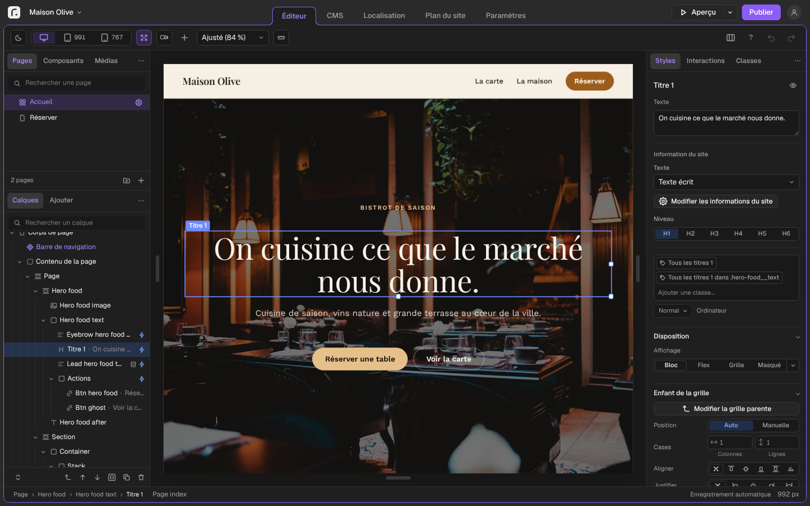
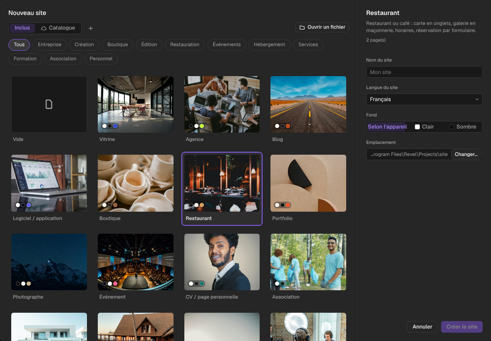
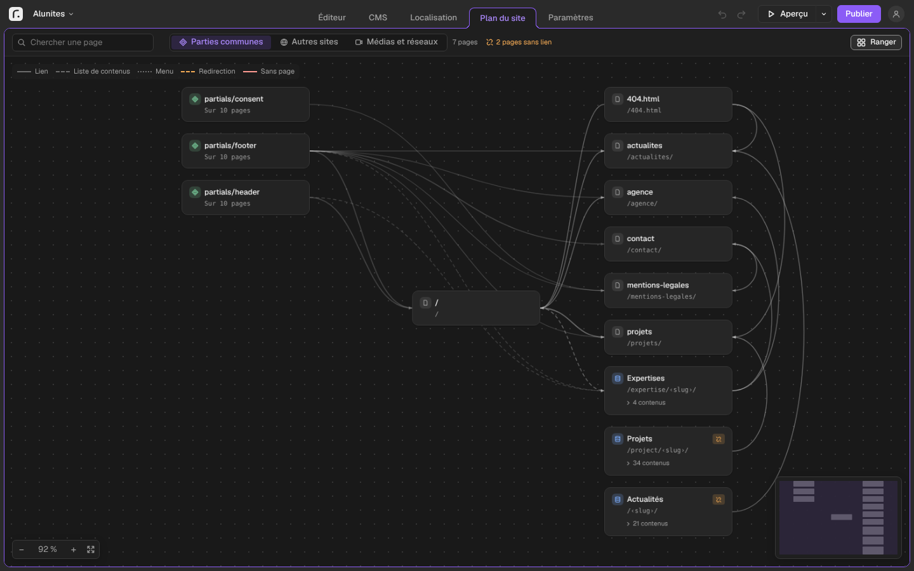
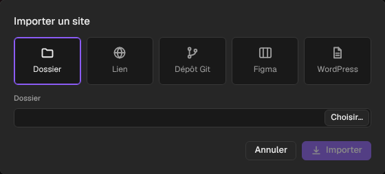

# Revel

**Créez votre site web sans écrire de code, puis mettez-le en ligne chez l'hébergeur de votre choix.**
Revel est une application gratuite pour Windows, macOS et Linux, dans 15 langues. Tout se fait sur votre
ordinateur : pas de compte à créer, pas d'abonnement, et votre site reste à vous.

> Version actuelle : **0.7.2**, en **préversion**. Revel est en cours de développement : l'essentiel fonctionne,
> mais attendez-vous à des défauts. Gardez une copie de vos sites importants.



**[Télécharger Revel](https://github.com/matv-studio/Revel/releases)** · [Installer](#installer-revel) ·
[Premiers pas](#premiers-pas) · [In English](#in-english) · [Pour les développeurs](#pour-les-développeurs)

## À quoi sert Revel

Revel s'adresse à celles et ceux qui veulent un site soigné sans passer par un développeur ni par un service en
ligne payant au mois. Si vous connaissez Webflow, Framer ou Figma, vous retrouverez la même façon de travailler.
Le site produit est fait de fichiers standards (pages HTML, feuilles de style, images) : vous pouvez l'héberger où
vous voulez, et il continue de fonctionner sans Revel.

<details>
<summary><b>Partir d'un modèle</b></summary>

26 modèles de site par métier (agence, restaurant, boutique, cabinet, événement, portfolio…), prêts à
personnaliser. Vous pouvez partager les vôtres sous forme de fichier ou de catalogue GitHub, et ouvrir ceux des
autres depuis « Nouveau site ».



</details>

<details>
<summary><b>Construire et adapter les pages</b></summary>

- **À l'écran.** Vous placez des éléments (titres, textes, images, boutons, blocs), vous les déplacez, vous
  écrivez directement dans la page. Les réglages (couleurs, polices, espacements, disposition) se font dans des
  panneaux, avec des contrôles visuels plutôt que du code. Tout reste modifiable depuis l'interface, y compris
  un site importé.
- **Pour chaque écran.** Ordinateur, tablette, téléphone : chaque taille d'écran se règle à part ; un titre peut
  s'ajuster à la taille de l'écran.
- **En clair et en sombre.** Couleurs du site pour les deux modes, avec un interrupteur pour vos visiteurs.
- **Réutiliser.** Composants (un en-tête, une carte, un pied de page) modifiés une fois pour toutes les pages,
  médias rangés en dossiers, images allégées automatiquement pour un site rapide.

</details>

<details>
<summary><b>Gérer des contenus et voir le site d'un coup d'œil</b></summary>

- **CMS.** Articles, projets, membres d'une équipe… sont rangés dans le CMS (gestion des contenus), chacun avec
  ses champs ; leurs pages se créent toutes seules à partir d'un modèle.
- **Plan du site.** Les pages, les collections et les menus reliés par leurs liens ; on y crée, renomme ou
  redirige une page, et les pages sans lien ou les liens cassés y sont signalés.



</details>

<details>
<summary><b>Animer, vendre, traduire</b></summary>

- **Animer.** Une quarantaine d'animations prêtes à l'emploi (apparitions, effets de texte, survol,
  défilement), animations Lottie exportées d'After Effects, menus qui s'ouvrent, onglets, accordéons,
  carrousels, éléments à glisser, horloge, toile de pixels à dessiner, transitions entre les pages.
- **Vendre.** Un panier et un bouton « Ajouter au panier », commande reçue par courriel, paiement par vos liens
  Stripe ou PayPal.
- **Traduire.** Un site en plusieurs langues ; la traduction automatique se fait sur votre ordinateur, sans
  envoyer vos textes à un service extérieur.

</details>

<details>
<summary><b>Mettre en ligne</b></summary>

La première fois, Revel vous guide pas à pas chez votre hébergeur (OVHcloud, o2switch, Infomaniak, Hostinger,
IONOS, ou tout autre hébergement qui accepte SFTP) ou sur GitHub Pages ; ensuite, un clic suffit. Il vérifie le
site avant chaque publication et peut revenir à la publication précédente. Il vous aide aussi à relier votre nom
de domaine et à recevoir par courriel les messages des formulaires du site.

</details>

<details>
<summary><b>Reprendre un site existant</b></summary>

Un dossier de pages HTML, un site en ligne à partir de son adresse (y compris un site Framer), un export Webflow
et les contenus de son CMS, un fichier Figma, un export WordPress, un dépôt Git ou un projet Eleventy. Un site à
construire (SvelteKit, Next.js, Astro, Hugo, Jekyll…) peut être construit par Revel, qui télécharge alors
lui-même les outils nécessaires. Le site repris est remis dans la forme de l'éditeur : calques, classes et
réglages des panneaux, sans code à reprendre à la main.



</details>

<details>
<summary><b>Travailler avec un assistant IA, garder l'historique, travailler à plusieurs</b></summary>

- **Assistant IA.** Claude, ChatGPT, LM Studio, Open WebUI… peuvent modifier votre site à votre demande, par la
  conversation, depuis votre ordinateur.
- **Historique.** Enregistrez des versions de votre site, comparez-les, revenez en arrière.
- **À plusieurs.** Chacun modifie sa copie du site puis synchronise, par un dossier partagé de votre réseau (NAS,
  serveur, sans compte) ou par un dépôt en ligne (GitHub, GitLab). Les modifications faites à des endroits
  différents se combinent ; un même endroit modifié par deux personnes se choisit en un clic.

</details>

## Installer Revel

1. Ouvrez la page des [versions de Revel](https://github.com/matv-studio/Revel/releases) et prenez la plus récente.
2. Dans « Assets », téléchargez **un seul** fichier, celui de votre ordinateur :

| Votre ordinateur | Fichier à télécharger |
|---|---|
| Windows 10 ou 11 | `Revel_…_x64-setup.exe` |
| Mac avec puce Apple (M1, M2, M3, M4…) | `Revel_…_aarch64.dmg` |
| Mac avec processeur Intel | `Revel_…_x64.dmg` |
| Linux (toutes distributions récentes) | `Revel_…_amd64.AppImage` |
| Linux Debian, Ubuntu | `Revel_…_amd64.deb` (au choix, à la place de l'AppImage) |

<details>
<summary>Quel Mac ai-je ? À quoi servent les autres fichiers ?</summary>

Menu Apple › « À propos de ce Mac » indique « Puce Apple M… » ou « Processeur Intel ».

Les autres fichiers servent à des cas particuliers : `.msi` pour un déploiement par un service informatique sous
Windows, `.rpm` pour Fedora et openSUSE. Ceux en `.sig`, `.app.tar.gz` et `latest.json` sont utilisés par les
mises à jour automatiques : inutile de les télécharger.

</details>

<details>
<summary><b>Premier lancement : l'avertissement de votre système</b></summary>

Revel n'est pas encore signé par un certificat d'éditeur (un service payant, prévu plus tard). Votre système vous
prévient donc la première fois :

- **Windows** : à l'écran « Windows a protégé votre ordinateur », cliquez sur « Informations complémentaires »,
  puis « Exécuter quand même ». L'installation se fait ensuite normalement.
- **macOS** : ouvrez le fichier `.dmg` et glissez Revel dans le dossier Applications. Au premier lancement, macOS
  refuse de l'ouvrir : allez dans Réglages Système › Confidentialité et sécurité, descendez jusqu'au message sur
  Revel et cliquez sur « Ouvrir quand même ». Sur macOS 14 ou plus ancien, un clic droit sur Revel › « Ouvrir »
  suffit.
- **Linux (AppImage)** : rendez le fichier exécutable (clic droit › Propriétés › « Autoriser l'exécution », ou
  `chmod +x Revel_*.AppImage`), puis double-cliquez. Sur Ubuntu, si rien ne se passe, installez la bibliothèque
  FUSE 2 : `sudo apt install libfuse2t64` (Ubuntu 24.04 et plus récent) ou `sudo apt install libfuse2`
  (Ubuntu 22.04).

</details>

## Premiers pas

1. **Créez ou reprenez un site.** Sur l'écran d'accueil, « Nouveau site » part d'une page vide ou d'un des
   modèles (« Plus » ouvre la galerie, les catalogues et les fichiers de modèle) ; « Importer » reprend un site
   existant ; « Ouvrir un site » rouvre un site Revel.
2. **Modifiez-le.** À gauche, les pages, les composants, les médias et la structure de la page (les calques) ;
   au centre, la page telle qu'elle s'affichera ; à droite, les styles et les interactions de l'élément choisi.
   Double-cliquez sur un texte pour l'écrire. L'onglet « Ajouter » propose les éléments à placer.
3. **Regardez le résultat.** « Aperçu » montre le site tel que vos visiteurs le verront, avant toute mise en
   ligne.
4. **Publiez.** « Publier » vous guide la première fois, puis met le site à jour en un clic.

Un guide intégré, « Premiers pas », s'ouvre depuis le bouton « ? » de l'éditeur. Chaque réglage est décrit quand
vous laissez la souris dessus.

<details>
<summary><b>Mises à jour</b></summary>

À partir de la version 0.6.0, Revel cherche une nouvelle version à chaque lancement. Quand il en trouve une, un
bouton « Version x.y.z » apparaît en haut à droite ; Réglages › Mises à jour l'installe et relance Revel. Chaque
mise à jour est vérifiée par sa signature avant d'être installée.

Les versions d'essai (préversions) ne sont proposées que si vous cochez « Recevoir les préversions » dans
Réglages › Mises à jour. Les versions antérieures à la 0.6.0 ne se mettent pas à jour seules : installez la
nouvelle version par-dessus.

</details>

<details>
<summary><b>Vos données</b></summary>

Vos sites restent dans des dossiers de votre ordinateur, que vous choisissez. Revel n'a pas de compte, ne mesure
pas votre utilisation et n'envoie rien de lui-même, en dehors de la recherche de mise à jour (sur GitHub). Il ne
se connecte ailleurs que lorsque vous le demandez : publier chez votre hébergeur, télécharger une langue de
traduction ou une police Google, importer un site depuis un lien, Figma ou Webflow, vérifier votre nom de
domaine, utiliser votre compte GitHub. Vos mots de passe et jetons d'accès sont gardés dans le trousseau sécurisé
de votre système, jamais dans un fichier.

</details>

<details>
<summary><b>Où en est le projet</b></summary>

Revel avance par étapes ; les sept premières sont terminées : socle, ouverture et publication d'un site, éditeur
visuel, contenus et site complet, assistants IA, mise en ligne directe, finition (animations, mises à jour, aide,
installateurs), import depuis d'autres outils. L'étape en cours ajoute des outils au fil des besoins (plan du
site, modèles, panier, langues de l'interface, imports entièrement modifiables…). La signature de l'application,
qui supprimera les avertissements du premier lancement, est prévue en option. Le détail est dans
[docs/PLAN.md](docs/PLAN.md), et les choix faits en chemin dans [docs/DECISIONS.md](docs/DECISIONS.md).

</details>

Un problème, une idée ? Ouvrez un ticket dans l'onglet [Issues](https://github.com/matv-studio/Revel/issues).

## In English

Revel is a free desktop app (Windows, macOS, Linux) to build a website visually, without code, and publish it to
the host of your choice. It works offline on your computer, with no account or subscription; the result is plain
HTML, CSS and images that you own.

<details>
<summary>What it does</summary>

The interface is available in 15 languages (Settings › General). Revel includes 26 site templates, a visual
editor, a CMS, components, animations, a site map, a cart with Stripe or PayPal payment links, multilingual sites
with on-device machine translation, one-click publishing (SFTP hosts or GitHub Pages), imports from Webflow,
Framer, Figma, WordPress, static HTML, Eleventy and Git repositories (sites that need building are built by Revel
on request; imported sites become fully editable in the panels, without code), team work through a shared network
folder or an online repository, and a local connector for AI assistants. Download the installer for your system
from the [releases page](https://github.com/matv-studio/Revel/releases). Revel is a pre-release (0.7.2): expect
rough edges, and keep a copy of important sites.

</details>

---

## Pour les développeurs

<details>
<summary>Architecture, modules, essais</summary>

Revel est écrit en Rust : une application de bureau [Tauri 2](https://tauri.app), une interface en
[Leptos](https://leptos.dev) compilée en WebAssembly, et un cœur découpé en bibliothèques indépendantes.

| Dossier | Rôle |
|---|---|
| `crates/revel-model` | Document de site (schéma versionné, migrations) |
| `crates/revel-edit` | Commandes d'édition réversibles, historique annuler/rétablir |
| `crates/revel-render` | Génération HTML du site statique, rendu des pages pour l'éditeur |
| `crates/revel-style` | Feuille de style : lecture, génération, points de rupture |
| `crates/revel-markup` | Lecture des gabarits (Nunjucks/Jinja) vers l'arbre de Revel |
| `crates/revel-project` | Projet sur disque : document de site, contenus, données, génération |
| `crates/revel-cms` | Contenus Markdown/YAML compatibles Pages CMS |
| `crates/revel-assets` | Images (AVIF, WebP, JPEG, PNG), images de partage |
| `crates/revel-import` | Import : Eleventy, HTML statique, site en ligne, Webflow, Figma, WordPress ; mise à plat des styles |
| `crates/revel-deploy` | Publication : hébergeurs, capacités, avertissements |
| `crates/revel-dns` | Noms de domaine |
| `crates/revel-git` | Git et GitHub : versions, travail à plusieurs, publication sur une branche, connexion, GitHub Pages |
| `crates/revel-build` | Construction des sites à construire (Node.js, Hugo, Jekyll) avant leur import |
| `crates/revel-translate` | Traduction automatique hors ligne (modèles OPUS-MT) |
| `crates/revel-mcp` | Serveur MCP pour les assistants IA |
| `crates/revel-i18n` | Textes de l'interface en 15 langues (Fluent) |
| `crates/revel-protocol` | Messages entre l'interface et le cœur |
| `crates/revel-core` | Services communs à l'application, à la ligne de commande et au serveur MCP ; modèles de site |
| `apps/revel-app` | Application de bureau (Tauri 2) |
| `apps/revel-ui` | Interface (Leptos, WebAssembly) ; système de design : [docs/DESIGN.md](docs/DESIGN.md) |
| `apps/revel-cli` | Ligne de commande `revel` (import, génération, diagnostic) |
| `docs/` | Architecture, plan, décisions, détail de chaque étape |

Détails : [docs/ARCHITECTURE.md](docs/ARCHITECTURE.md).

```sh
cargo test --workspace          # tous les tests
cargo run -p revel-cli -- info  # ligne de commande
cargo tauri dev                 # application (depuis apps/revel-app ; tauri-cli et trunk requis)
```

La version de Rust est fixée par `rust-toolchain.toml` (installée automatiquement par rustup). Essais de bout en
bout (Linux) : `tools/editor-e2e.mjs` (interface dans Chromium reliée à un vrai cœur par
`revel canvas-serve --bridge`) et `tools/app-e2e.mjs` (application elle-même, par `tauri-driver`) ; les commandes
exactes sont dans `.github/workflows/ci.yml`. L'intégration continue tourne sous Linux, Windows et macOS à chaque
envoi. Les installateurs sont construits par le workflow *Installateurs* (lancé à la main) ; les étiquettes par le
workflow *Étiquette*.

Chaque étape terminée reçoit une étiquette Git `step-N` (`git checkout step-5` restaure l'état exact), et chaque
module peut revenir seul à une étape tant que son interface publique n'a pas changé
(`git checkout step-5 -- crates/revel-deploy`).

</details>

## Licence

Aucune licence n'est encore choisie (décision D-08 ouverte) : le code est visible, mais tous les droits sont
réservés ; il ne peut être ni copié, ni redistribué, ni modifié sans autorisation.
